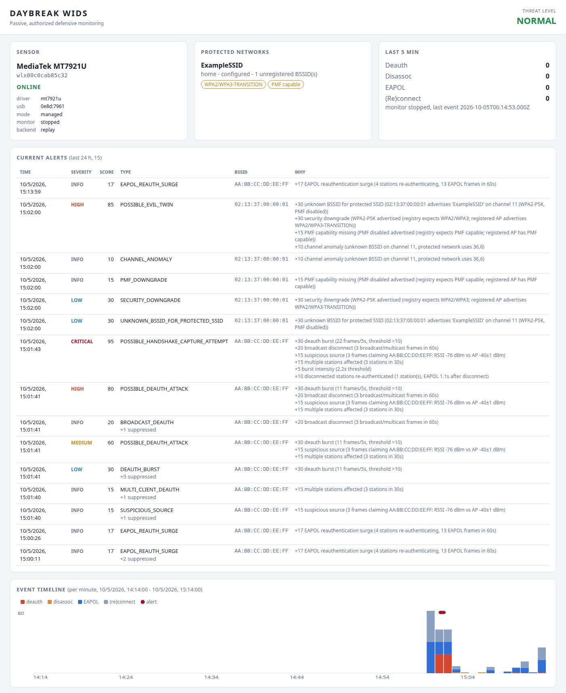

# Daybreak WIDS

**Passive, defensive wireless intrusion detection for Linux.**

> [!IMPORTANT]
> **Authorized defensive monitoring only.**
> Daybreak WIDS does not implement packet injection, deauthentication attacks,
> credential cracking, password recovery, or active exploitation.
> Only use this project on wireless networks you own or have explicit
> authorization to monitor.

Daybreak WIDS monitors authorized Wi-Fi networks for suspicious deauthentication
activity, abnormal EAPOL reauthentication, evil-twin indicators, security
downgrade signals and related wireless anomalies. It only *receives* frames, and
every alert lists the signals that produced its risk score.

**What it detects**

- deauthentication / disassociation anomalies (bursts, broadcast disconnects, many clients at once, spoofed-looking senders)
- EAPOL reauthentication surges and disconnect → reauthentication sequences
- possible evil twins: unregistered BSSIDs advertising a protected SSID
- security downgrades: WPA3 → WPA2, PMF removed, changed encryption
- WPA2 / WPA3 / PMF / WPS configuration issues (passive audit from beacons)

**Development and test environment**

| | |
|---|---|
| Host | Ubuntu 26.04.1 LTS, Linux 7.0, LattePanda 3 Delta |
| Sensor | ALFA USB adapter, MediaTek MT7921U (USB `0e8d:7961`), driver `mt7921u`, 2.4 / 5 / 6 GHz, monitor mode supported (live capture: see validation status) |
| Python | 3.10, 3.11, 3.12, 3.13, 3.14 |
| Tests | 478 automated tests: synthetic frames and metadata, a simulated Kismet API; no hardware, root or radio needed |

**Validation status** (details: [docs/VALIDATION.md](docs/VALIDATION.md))

| Area | Status |
|---|---|
| Automated test suite on Python 3.10–3.14 | PASS (478 tests) |
| Sensor discovery and readiness checks on the ALFA MT7921U | PASS (read-only, on the tested host) |
| Internet interface (`wlo1`) untouched by sensor checks | PASS (before/after snapshots) |
| Live passive capture on the ALFA in monitor mode | NOT VERIFIED YET (needs root; guided procedure: [`scripts/hardware-smoke-test.sh`](scripts/hardware-smoke-test.sh)) |
| Real Kismet server | NOT VERIFIED ON REAL KISMET (tested against a simulated Kismet REST API only) |

---

## Contents

- [Why this exists](#why-this-exists)
- [Try it without hardware](#try-it-without-hardware)
- [What it detects](#what-it-detects)
- [What it does not do](#what-it-does-not-do)
- [Architecture](#architecture)
- [Privacy design](#privacy-design)
- [Requirements](#requirements)
- [Installation](#installation)
- [Quick start](#quick-start)
- [Kismet backend](#kismet-backend)
- [Passive backend](#passive-backend)
- [Baseline, alerts and audits](#baseline-alerts-and-audits)
- [Dashboard](#dashboard)
- [Data, logs and file locations](#data-logs-and-file-locations)
- [Safety model](#safety-model)
- [Testing](#testing)
- [Limitations](#limitations)
- [Documentation](#documentation)

## Why this exists

Deauthentication and disassociation frames are how Wi-Fi access points and
stations end a connection. Without Protected Management Frames (PMF, 802.11w)
they are not authenticated, so anyone in radio range can forge them, however
strong the WPA2/WPA3 passphrase is. Forged disconnects knock clients offline and
make them reconnect, and every WPA2-Personal (PSK) reconnect repeats the 4-way
handshake that an offline dictionary attack needs (a captured WPA3-SAE handshake
does not allow offline guessing).

Disconnects are also completely normal. Clients roam, sleep and walk out of
range; access points reboot, kick idle stations and steer clients between bands.
A single deauthentication frame says almost nothing, so Daybreak never treats
one as an attack. Instead it scores and correlates several passive signals
(default weights shown):

```text
  deauth burst                (more than 10 frames in 5 s)      30
+ several stations affected   (3 or more stations in 30 s)      15
+ EAPOL reauthentication surge                                  17
+ the same stations re-authenticate right after                 10
---------------------------------------------------------------------
= 72  POSSIBLE_HANDSHAKE_CAPTURE_ATTEMPT  (HIGH)
```

With the default weights a single attack-detection signal stays in the INFO or LOW
band (the operational alerts `SENSOR_LOST` and `PROTECTED_INTERFACE_CHANGED` score
50, MEDIUM). Only correlated combinations can reach HIGH or CRITICAL; with few
signals they stay LOW or MEDIUM. Every alert prints its score components. A
correlated alert describes a pattern ("consistent with an attempt to capture a WPA
handshake"); Daybreak does not claim that an attack happened or succeeded.

## Try it without hardware

The repository ships synthetic metadata streams (no captured frames, no key
material). Replaying one with `--dry-run` prints alerts and writes nothing:

```bash
daybreak-wids -c config.example.yaml --dry-run monitor start --replay tests/fixtures/handshake_pattern.jsonl
```

<!-- output-of: daybreak-wids -c config.example.yaml --dry-run monitor start --replay tests/fixtures/handshake_pattern.jsonl -->
```text
$ daybreak-wids -c config.example.yaml --dry-run monitor start --replay tests/fixtures/handshake_pattern.jsonl
Authorized defensive monitoring only. daybreak-wids is passive: it never constructs, injects or sends 802.11 frames.
dry-run: nothing is written to the database, logs or desktop; alerts are printed only.
backend replay open: replaying tests/fixtures/handshake_pattern.jsonl
2026-10-05 15:01:41 LOW DEAUTH_BURST
...
2026-10-05 15:01:41 MEDIUM POSSIBLE_DEAUTH_ATTACK
...
2026-10-05 15:01:41 HIGH POSSIBLE_DEAUTH_ATTACK
...
2026-10-05 15:01:43 CRITICAL POSSIBLE_HANDSHAKE_CAPTURE_ATTEMPT
Network=home SSID=ExampleSSID
BSSID=AA:BB:CC:DD:EE:FF
Channel=36
Frames=22/5s
AffectedStations=4
ReauthenticatedStations=1
Sensor=replay
Risk 95 CRITICAL
+30 deauth burst (22 frames/5s, threshold >10)
+20 broadcast disconnect (3 broadcast/multicast frames in 60s)
+15 suspicious source (3 frames claiming AA:BB:CC:DD:EE:FF: RSSI -76 dBm vs AP -40±1 dBm)
+15 multiple stations affected (3 stations in 30s)
+5 burst intensity (2.2x threshold)
+10 disconnected stations re-authenticated (1 station(s), EAPOL 1.1s after disconnect)
Summary=Disconnect burst followed by re-authentication of the affected stations: consistent with an attempt to capture a WPA handshake. Whether a handshake was obtained is not determined.

processed 192 events (0 duplicates, 0 out of scope, 0 malformed); alerts delivered 8, suppressed 8; threat level CRITICAL
```

This block is checked against the real output by `tests/test_readme.py` (timestamps
are printed in your local time zone). The alert escalates from LOW (burst alone)
through MEDIUM and HIGH (more disconnect signals) to CRITICAL (disconnects followed
by re-authentication). The other fixtures, replayed the same way with
`config.example.yaml`:

| Fixture | Simulates | Result |
|---|---|---|
| `normal.jsonl` | 15 min of ordinary traffic: connections, roaming between the two registered radios, an idle-station disconnect, group rekeys, one AP restart (single broadcast deauth) | no alert at LOW or above; threat level NORMAL |
| `deauth_burst.jsonl` | 37 disconnect frames in under 5 s claiming the AP, ~35 dB weaker than its beacons | LOW `DEAUTH_BURST`, then HIGH `POSSIBLE_DEAUTH_ATTACK` (80) |
| `handshake_pattern.jsonl` | two disconnect bursts, each followed by all four stations re-authenticating | CRITICAL `POSSIBLE_HANDSHAKE_CAPTURE_ATTEMPT` (95) |
| `evil_twin.jsonl` | unregistered BSSID advertises the protected SSID with WPA2-PSK only, PMF disabled, on another channel | HIGH `POSSIBLE_EVIL_TWIN` (85) |
| `sensor_flap.jsonl` | the sensor adapter disappears and returns | MEDIUM `SENSOR_LOST`, then INFO `SENSOR_RECOVERED` |
| `malformed.jsonl` | broken lines, a duplicate, fake key-material fields | 6 malformed lines skipped, 1 duplicate dropped, key-material fields stripped |

## What it detects

### Deauthentication / disassociation

| Signal | Default points | Trigger (defaults, all configurable under `detection.deauth`) |
|---|---|---|
| `DEAUTH_BURST` | 30 | more than 10 deauth/disassoc frames for one BSSID within 5 s |
| `BROADCAST_DEAUTH` | 20 | 3 or more broadcast/multicast disconnects within 60 s |
| `MULTI_CLIENT_DEAUTH` | 15 | 3 or more distinct stations disconnected within 30 s |
| `SUSPICIOUS_SOURCE` | 15 | 3 or more frames claiming the AP's address within 30 s that look forged: RSSI far from the AP's learned signal, wrong channel, invalid reason code, or unprotected on a PMF-required network |
| `INVALID_REASON_CODE` | 5 | reserved / undefined reason code |

### EAPOL

Only the EAPOL message number (1–4, inferred from the 2-byte Key Information
field) and frame counts are used.

| Signal | Default points | Trigger |
|---|---|---|
| `EAPOL_REAUTH_SURGE` | 17 | per station: 3 or more handshakes or 12 or more EAPOL frames in 60 s; per BSSID: 4 or more stations or 40 or more frames in 60 s (retransmitted message 1 counts once) |
| disconnect → re-authentication | 10 | a station disconnected in an incident runs EAPOL again within 30 s (part of the correlated alert below) |

### Access point identity and security

Compared against the protected-network registry, the learned baseline and the
registered AP's own previous beacons.

| Signal | Default points | Trigger |
|---|---|---|
| `UNKNOWN_BSSID_FOR_PROTECTED_SSID` | 30 | an unregistered BSSID advertises a protected SSID (a warning, not a verdict: it may be your own extender) |
| `SECURITY_DOWNGRADE` | 30 | weaker security than the registry expects or the registered AP advertises, e.g. WPA3 → WPA2 |
| `PMF_DOWNGRADE` | 15 | PMF required/capable → weaker |
| `ENCRYPTION_CHANGE` | 15 | other capability change on a registered BSSID |
| `CHANNEL_ANOMALY` | 10 | channel outside the registry / baseline |
| `INCOMPATIBLE_DUPLICATE_SSID` | 20 | same SSID with incompatible security (e.g. open vs WPA2) |

### Kismet WIDS alerts

With the Kismet backend, Kismet's own alerts are reused rather than re-implemented
and mapped to the same scoring category as Daybreak's detector, so one phenomenon
is counted once: `DEAUTHFLOOD`, `BCASTDISCON`, `DISASSOCTRAFFIC`,
`DISCONCODEINVALID`, `DEAUTHCODEINVALID`, `APSPOOF`, `ADVCRYPTCHANGE`,
`CRYPTODROP`, `CHANCHANGE` (`NOCLIENTMFP` is informational, 0 points).

### Correlated alerts

| Alert | Raised when |
|---|---|
| `POSSIBLE_DEAUTH_ATTACK` | a deauth burst or broadcast disconnects, plus another disconnect signal (or 50 or more points) for the same BSSID |
| `POSSIBLE_HANDSHAKE_CAPTURE_ATTEMPT` | the above incident disconnected stations, and EAPOL activity *follows* it (a surge, or the same stations re-authenticating) |
| `POSSIBLE_EVIL_TWIN` | an unregistered BSSID for a protected SSID with weaker or incompatible security, or a BSSID alternating between security profiles; concurrent disconnects add points |
| `SENSOR_LOST` / `SENSOR_RECOVERED` | the sensor adapter disappeared or returned (found again by MAC, even under a new name), or the Kismet datasource failed |
| `PROTECTED_INTERFACE_CHANGED` | a protected interface (the internet link) changed state during a live run; automatic sensor re-preparation stops for the run |

Scores add up, are capped at 100 and map to bands: 0–29 INFO, 30–49 LOW,
50–69 MEDIUM, 70–89 HIGH, 90–100 CRITICAL. Weights live under `scoring.weights`.

### Configuration audit

`daybreak-wids audit security` reports, from received beacons only: WPA2, WPA3-SAE,
WPA2/WPA3 transition mode, PMF capable / required, WPS advertised, weak ciphers,
and unregistered BSSIDs for each protected SSID. `daybreak-wids audit policy` is a
passphrase and router-hygiene checklist; it never asks for the passphrase.

## What it does not do

| Daybreak WIDS does | Daybreak WIDS never does |
|---|---|
| Parse management-frame metadata (addresses, reason codes, RSN/PMF capabilities) | Construct, transmit, inject or replay frames |
| Count EAPOL frames per station / BSSID (message number only) | Store or export handshakes, nonces, MICs or PMKIDs |
| Correlate disconnect bursts with re-authentication | Crack, verify or guess passphrases |
| Audit WPA2 / WPA3 / PMF / WPS from beacons | Ask for, store or log your Wi-Fi passphrase |
| Raise console / JSONL / desktop alerts | Change access-point settings or the internet interface |
| Put the *dedicated sensor* into monitor mode, when you ask for it | Take countermeasures against suspected attackers |

## Architecture

```text
              +--------------------------------------------+
              |  dedicated sensor adapter, monitor mode    |
              |  (tested: ALFA, MediaTek MT7921U)          |
              +---------------------+----------------------+
                                    | received 802.11 frames
                 +------------------+--------------------+
                 v                                       v
  +-------------------------------+      +--------------------------------+
  | Kismet (preferred when        |      | built-in passive backend       |
  | reachable)                    |      | AF_PACKET socket (only read),  |
  | REST + eventbus: WIDS alerts, |      | radiotap / 802.11 parser,      |
  | AP records, datasource health |      | guarded channel hopping        |
  | + optional frame tap (read)   |      | (sensor only)                  |
  +---------------+---------------+      +----------------+---------------+
                  +------------------+--------------------+
                                     | metadata events (allow-listed fields)
                                     |       also: --replay JSONL, --pcap file
                                     v
  +-----------------------------------------------------------------------+
  | Daybreak pipeline                                                     |
  |  dedup -> scope (protected networks only by default) -> detectors     |
  |  [deauth/disassoc] [EAPOL] [AP spoof/downgrade] [Kismet] [baseline]   |
  |  -> correlation engine -> explained risk score -> alert manager       |
  +--------+-------------------------+---------------------------+--------+
           v                         v                           v
   SQLite (metadata only)     human log + JSONL          console / desktop
           |                  (size-rotated)             notifications
           v
   CLI: alerts, report, audit, baseline   |   dashboard (read-only, 127.0.0.1)

  Interface guard: every command that changes an interface is checked first;
  protected interfaces (wlo1), the default-route interface and their PHY
  siblings are refused, and protected interfaces are snapshotted before/after.
  Sensor health monitor: SENSOR_LOST / SENSOR_RECOVERED.
```

- **Kismet first.** `backend.type: auto` uses Kismet when it is reachable. Kismet
  owns the capture source and channel control, and its WIDS alerts are reused.
  Kismet's REST API does not expose per-frame deauth/EAPOL metadata, so Daybreak
  can additionally read frames from the monitor interface Kismet opened through
  a receive-only socket (the *frame tap*, needs `CAP_NET_RAW`).
- **Fallback.** Without Kismet, the passive backend reads the monitor-mode sensor
  directly and hops over the protected networks' channels.
- **Offline.** `--replay file.jsonl` (metadata streams) and `--pcap file.pcapng`
  (existing captures, read-only) run the same pipeline.

## Privacy design

- Daybreak does not request or store Wi-Fi passwords. There is no option, prompt
  or config key for a passphrase.
- It does not capture or export WPA handshakes. For EAPOL-Key frames only the
  2-byte Key Information field is read, to infer the message number (1–4); for
  EAP packets only the code. Nonces, MICs, key data, replay counters and PMKIDs
  are never parsed into events.
- Event metadata passes an allow-list before storage; keys such as `nonce`,
  `mic`, `key_data`, `replay_counter`, `pmkid`, `psk`, `passphrase`, `raw`,
  `packet` or `eap_identity` are dropped even if a backend supplies them, and
  values must be scalars (only the HT/VHT/HE/EHT capability flags are
  structured), so nested data cannot carry key material either.
- Kismet device records are requested with an explicit field allow-list and
  filtered again on receipt; only read-only Kismet endpoints are called.
- With the default `detection.scope: protected`, frames that name no registered
  BSSID, and beacons for other SSIDs, are not analysed or stored (a frame that
  names a registered BSSID is in scope whatever its other addresses are). Beacons
  are summarised per AP, not stored per frame.
  Kismet alerts count as yours only if they name a registered BSSID or quote a
  protected SSID exactly.
- What *is* stored: MAC addresses of APs and stations seen on your protected
  networks, SSIDs, channels, signal strength, security capabilities, reason codes
  and alert history, in owner-only files. Treat the database and logs as personal
  data. The live monitor deletes events, alerts, sensor status and station/AP
  records older than `storage.retention_days` (30 by default), and rotated log
  files last written before that. Protected-network entries and learned
  baselines are kept until you delete them; baselines list registered BSSIDs,
  their signal statistics and up to 64 unregistered BSSIDs seen while learning.
  The current log file is size-rotated and can hold older lines until it
  rotates.

## Requirements

- Linux with `iw` and `ip` (iproute2). NetworkManager / `nmcli` is optional
  (used read-only for diagnostics, and to stop managing the sensor during
  `sensor prepare`).
- Python 3.10 or newer. Runtime dependencies: `PyYAML>=6`, `click>=8.1`.
  Optional extras: `dashboard` (`fastapi>=0.110`, `uvicorn>=0.27`), `eventbus`
  (`websocket-client>=1.6`), `dev` (`pytest>=8`, `httpx>=0.27`).
- For live monitoring, a **dedicated** Wi-Fi adapter whose driver supports
  monitor mode, plus root for the passive backend (`CAP_NET_ADMIN` for monitor
  mode and channels, `CAP_NET_RAW` for the capture socket) or Kismet (then
  Daybreak needs `CAP_NET_RAW` only for the optional frame tap).
- Optional: [Kismet](https://www.kismetwireless.net/).

Tested sensor: ALFA USB adapter with MediaTek MT7921U, Linux driver `mt7921u`.

## Installation

```bash
git clone https://github.com/<owner>/daybreak-wids.git
cd daybreak-wids
python3 -m venv .venv
. .venv/bin/activate
pip install -e .                   # core
pip install -e '.[dashboard]'      # optional: local dashboard
pip install -e '.[eventbus]'       # optional: Kismet eventbus (websocket)
```

For development (the dashboard and eventbus extras are needed for their tests):

```bash
pip install -e '.[dev,dashboard,eventbus]'
pytest
```

## Quick start

**1. Check the sensor (read-only).** `sensor list` shows every wireless interface
and its role; `sensor check` diagnoses the configured sensor and proves the
protected interfaces were not changed. Output on the tested host:

```text
$ daybreak-wids sensor list
IFACE            PHY   DRIVER   BUS            BANDS(GHz)  MONITOR  MODE     CH  REG  NM            ROLE
---------------  ----  -------  -------------  ----------  -------  -------  --  ---  ------------  --------------------------
wlo1             phy0  iwlwifi  pci            2.4/5       yes      managed  9   KR   connected     protected (never modified)
wlx00c0cab85c32  phy3  mt7921u  usb 0e8d:7961  2.4/5/6     yes      managed  -   KR   disconnected  sensor

$ daybreak-wids sensor check
...
[ok  ] isolation: dedicated adapter (not protected, no default route, separate PHY)
[ok  ] monitor: monitor mode supported
...
[ok  ] protected-interfaces: unchanged (wlo1)
```

The sensor (`sensor.interface`, default `wlx00c0cab85c32`), the adapter it must
be (`sensor.expected_driver`, default `mt7921u`, and optionally
`sensor.expected_mac`) and the protected interfaces
(`sensor.protected_interfaces`, default `wlo1`) are set in the configuration;
take the values for your adapter from `sensor list`. `sensor prepare` refuses an
adapter whose driver or MAC does not match. Never configure the interface that
carries your internet connection as the sensor; Daybreak refuses to modify it
anyway.

**2. Register the networks you administer.**

```bash
cp config.example.yaml config.yaml
${EDITOR:-nano} config.yaml          # replace the example network under protected_networks
```

or, for additional networks:

```bash
daybreak-wids network add --name office --ssid 'Office WiFi' \
    --bssid AA:BB:CC:00:00:01 --channel 149 --expect WPA2 --expect WPA3 --pmf capable
daybreak-wids network list
```

A network registered without a BSSID is shown as `unconfigured`: BSSIDs heard
advertising its SSID are listed as *candidates* by `network list` and
`audit security`, and none is ever adopted automatically.

**3. Preview with `--dry-run`.** The global `--dry-run` flag shows what would
happen without changing interfaces or writing anything:

```bash
daybreak-wids --dry-run sensor prepare --apply --channel 149   # prints the plan, executes nothing
daybreak-wids --dry-run network add --name lab --ssid 'Lab WiFi'
```

**4. Monitor, then review.**

```bash
daybreak-wids monitor start          # Kismet if reachable, otherwise the passive backend (see below)
daybreak-wids monitor status
daybreak-wids alerts --details
daybreak-wids report
```

Configuration is read from `-c FILE`, `$DAYBREAK_WIDS_CONFIG`, `./config.yaml`
or `~/.config/daybreak-wids/config.yaml` (first found). Relative paths in it are
resolved against the directory of the config file.

## Kismet backend

Kismet is the preferred backend when available: it manages the capture source
and channels, and its WIDS alerts are reused. Daybreak itself needs no root with
Kismet, except for the optional frame tap (`CAP_NET_RAW`, see below).

> Daybreak's Kismet integration has been tested against a simulated Kismet REST
> API only. It is **not yet verified against a real Kismet server**.

1. Install Kismet from the Kismet project's own packages
   (<https://www.kismetwireless.net/>); some distributions package it too. The
   Ubuntu 26.04 archive on the tested host has no `kismet` package. Versions
   differ between distributions.
2. Generate a reviewed `kismet_site.conf` snippet (it writes nothing):

   <!-- output-of: daybreak-wids -c config.example.yaml --dry-run kismet config -->
   ```text
   $ daybreak-wids -c config.example.yaml --dry-run kismet config
   # Suggested by daybreak-wids -- review, then add to /etc/kismet/kismet_site.conf
   # Sensor: dedicated adapter only. Never add the internet interface (wlo1).
   source=wlx00c0cab85c32:name=daybreak,channels="6,36"

   # Kismet APSPOOF: authorized BSSIDs per protected SSID
   apspoof=home:ssid="ExampleSSID",validmacs="AA:BB:CC:DD:EE:FF,AA:BB:CC:DD:EE:F0"

   # daybreak-wids stores metadata only. Kismet's own logs can contain full frames,
   # including WPA handshakes. Disable them unless you need them for other purposes:
   enable_logging=false
   ```

3. Start Kismet, log in to its web UI and create an API key with the
   **readonly** role (see Kismet's [login and API key documentation](https://www.kismetwireless.net/docs/api/login/)).
   Keep the key out of files in this repository; Daybreak reads it from the
   environment variable named by `backend.kismet.api_key_env`:

   ```bash
   export KISMET_API_KEY='...'
   daybreak-wids kismet check         # reachability, datasource state, available WIDS alerts
   daybreak-wids monitor start
   ```

Daybreak calls only read-only Kismet endpoints (system status, datasources, alert
definitions, alerts since a timestamp, devices since a timestamp with a field
allow-list, active logs) and, if `websocket-client` is installed, the eventbus.
Credentials travel only in request headers (never in a URL). Neither the REST
client nor the eventbus connection follows redirects or uses a proxy from the
environment (Daybreak opens the eventbus socket itself), and `kismet check` and
`monitor start` warn if credentials would cross the network unencrypted.
For per-frame metadata (deauth reason codes, EAPOL message counts, beacon RSN
parsing) it taps the monitor interface Kismet opened; that needs `CAP_NET_RAW`.
Without it, detection relies on Kismet's WIDS alerts and AP records, and
handshake-capture correlation is not available (the `backend` line of
`monitor status`, and the monitor's start message, say whether the frame tap is
active). `sudo` drops environment variables, so a root-run monitor needs
`sudo --preserve-env=KISMET_API_KEY ...`. If anything answers at the Kismet URL
but the request fails (for example a rejected key), Daybreak stops instead of
falling back to the passive backend, which would compete with Kismet for the
sensor.

## Passive backend

Without Kismet, Daybreak reads frames from the sensor itself through an
`AF_PACKET` socket that it only reads from.

> Monitor mode disconnects an adapter from any network. Use a **dedicated USB
> adapter** for the sensor, never the interface that provides your internet
> connection. Daybreak refuses to modify protected interfaces, the
> default-route interface and anything on the same PHY.

Run from the repository directory. `sudo` resets `PATH` and `HOME`, so call the
venv's executable explicitly and always pass `-c`:

```bash
daybreak-wids -c config.yaml sensor prepare --channel 149                  # print the plan only
sudo .venv/bin/daybreak-wids -c config.yaml sensor prepare --apply --channel 149
sudo .venv/bin/daybreak-wids -c config.yaml monitor start --backend passive
sudo .venv/bin/daybreak-wids -c config.yaml sensor release --apply         # back to managed mode
```

`sensor prepare` runs exactly these commands, on the sensor only:

```text
nmcli device set wlx00c0cab85c32 managed no
ip link set wlx00c0cab85c32 down
iw dev wlx00c0cab85c32 set type monitor
ip link set wlx00c0cab85c32 up
iw dev wlx00c0cab85c32 set channel 149
```

and `sensor release` reverses them (`set type managed`, `managed yes`). Once the
adapter is handed back, NetworkManager treats it like any Wi-Fi adapter and may
scan or connect with it; that is NetworkManager, not Daybreak. `--apply` is
refused without `CAP_NET_ADMIN`, when the adapter's driver or MAC is not the
configured sensor's, and while the sensor is in use: connected or associated, or
in access-point, ad-hoc or mesh mode (taking a connected adapter down makes it
send its own deauthentication). `prepare` is also refused while a configured
protected interface does not exist (a misspelled name would protect nothing);
`release` only warns about that, so the sensor can always be handed back.

After a USB reset the adapter usually returns in managed mode. With
`sensor.auto_prepare: true` the live monitor restores monitor mode only if the
returning interface is the configured sensor (same name, or `expected_mac` and
`expected_driver`), all protected interfaces are present and the adapter is not
in use. While a protected interface differs from its state at start, automatic
re-preparation is suspended (alert `PROTECTED_INTERFACE_CHANGED`); it resumes
once the interface is back (status record `PROTECTED_RESTORED`). `sensor check`
prints the NetworkManager `unmanaged-devices=mac:...` line you can add yourself to
keep NetworkManager away permanently; Daybreak never edits system configuration.

Files created by a monitor run through `sudo` are owner-only and handed back to
the user who ran `sudo`, so the normal-user CLI and dashboard can read them.

**Guided hardware smoke test.** [`scripts/hardware-smoke-test.sh`](scripts/hardware-smoke-test.sh)
runs the steps above with checks in between: it records the protected interface
(NetworkManager state, operstate, type, link flags, default route) before every
step and stops if it changes, runs a time-limited passive monitor while you
reconnect one of your own devices, releases the sensor, and writes a counts-only
summary. `scripts/hardware-smoke-test.sh discover` lists the BSSIDs heard for an
SSID-only registration so you can confirm and register your own.

## Baseline, alerts and audits

**Baseline.** `daybreak-wids baseline create` learns, during a period without
known attacks, per-minute disconnect / EAPOL / connection rates (median, MAD,
p95, max), registered BSSIDs, channels, security capabilities, per-BSSID signal
strength and the client-count range, live (`--duration`), from `--replay` /
`--pcap`, or `--from-db`. `BASELINE_DEVIATION` (9–15 points) is raised only when
a rate is far above the learned median *and* above the learned maximum.

**Alerts.** Repeats of the same alert type for the same network are suppressed for
`alerts.cooldown` (300 s) unless the score rises by `escalation_delta` (10) or the
severity increases; the next alert reports how many were suppressed. A
suppressed repeat is only counted on the earlier alert, so the details of a
second, similar alert inside the cooldown (for example another unregistered
BSSID) show up in `audit security` and the AP table, not as an alert of its own.
During a flood from random BSSIDs, new alerts about BSSIDs outside the protected
networks are limited to 6 per alert type and minute (the rest are counted as
`flood_suppressed`); alerts about protected networks are never held back.
Console and desktop notifications are rate limited per minute and severity band
(`alerts.rate_limit_per_minute`); JSONL is not. Built-in notifiers: console,
JSONL and desktop (`notify-send`); others (webhooks, chat, e-mail) can be added
by registering a `Notifier` subclass (`daybreak/alerts/base.py`).

```bash
daybreak-wids alerts --since 24h --severity high --details
daybreak-wids alerts --ack 16
daybreak-wids report --since 7d --format json
```

**Audits.** Output for the synthetic fixtures (`normal.jsonl` and
`evil_twin.jsonl` replayed into a scratch database):

```text
$ daybreak-wids audit security
SSID: ExampleSSID  (network 'home', configured)

Security             : WPA2/WPA3-TRANSITION
WPA2/WPA3 Transition : enabled
PMF                  : capable
PMF required         : no
WPS advertised       : no
  AA:BB:CC:DD:EE:F0  ch   6  WPA2/WPA3-TRANSITION   last seen 2026-10-05 15:14:03
  AA:BB:CC:DD:EE:FF  ch  36  WPA2/WPA3-TRANSITION   last seen 2026-10-05 15:14:00
Unregistered BSSIDs:
  02:13:37:00:00:01  ch  11  WPA2-PSK

Findings:
  [WARN] unregistered BSSIDs advertise this SSID - 02:13:37:00:00:01
  [INFO] WPA2/WPA3 transition mode - WPA2-PSK remains available, so clients can still be steered to the weaker method
  [INFO] PMF capable (optional) - clients that do not negotiate PMF can still be disconnected by spoofed frames

Recommendation:
  Consider WPA3-SAE + PMF required if every client supports it.

(daybreak-wids never changes AP settings; apply changes on the router yourself.)
```

## Dashboard

```bash
pip install -e '.[dashboard]'
daybreak-wids dashboard            # http://127.0.0.1:8765/
```

Read-only (GET only; other methods get 405), bound to `127.0.0.1` by default,
accepts only allow-listed `Host` headers (DNS-rebinding protection), sends a strict
Content-Security-Policy and other security headers on every response, handles at
most 16 requests at a time, and loads no external resources. Responses are built
from field allow-lists (no process IDs, paths or backend error texts); alert
explanations can name client MAC addresses. Panels: sensor, protected networks,
current alerts with score breakdown, event timeline, AP security, baseline and
threat level. When no live data exists, the timeline and alerts show the most recent
recorded period (for example a replayed capture), labelled as such.

The dashboard has **no authentication**: any local user can read it. Binding to
another address needs `dashboard.allow_remote: true`, and requests are then
accepted only for the bind address and the names in `dashboard.allowed_hosts`
(literal host names or IP addresses; wildcards and ports are refused). Binding to
all interfaces (`0.0.0.0`, `::`) needs `allowed_hosts`.



*Synthetic fixtures only (`handshake_pattern.jsonl` and `evil_twin.jsonl`, plus a
baseline learned from `normal.jsonl`) replayed into a scratch database. The
threat level covers the last 5 minutes, so it reads NORMAL for recorded data.*
To reproduce (the copied example config also sends HIGH alerts to the desktop;
remove its `desktop` notifier if you do not want that):

```bash
mkdir -p /tmp/daybreak-demo && cp config.example.yaml /tmp/daybreak-demo/config.yaml
for f in handshake_pattern evil_twin; do
  daybreak-wids -c /tmp/daybreak-demo/config.yaml monitor start --quiet --replay tests/fixtures/$f.jsonl
done
daybreak-wids -c /tmp/daybreak-demo/config.yaml baseline create --replay tests/fixtures/normal.jsonl
daybreak-wids -c /tmp/daybreak-demo/config.yaml dashboard
```

## Data, logs and file locations

| What | Default location (relative to the config file's directory) |
|---|---|
| SQLite database (`networks`, `aps`, `stations`, `events`, `alerts`, `baselines`, `sensor_status`; schema versioned with `PRAGMA user_version`) | `storage.database`: `var/daybreak.db` in `config.example.yaml` |
| Human-readable log and alert JSONL, size-rotated (`max_bytes`, `backup_count`) | `logging.directory`: `var/log/daybreak.log`, `var/log/alerts.jsonl` |
| Monitor status | `monitor.status.json` next to the database |
| Networks added with `network add` | `registry_file`: `networks.yaml` |

Without any config file, data goes to `~/.local/share/daybreak-wids/`. Files are
created owner-only (`0600`, directories `0700`). The live monitor deletes events,
alerts, sensor status and station/AP records older than `storage.retention_days` (30
by default, checked hourly; `0` keeps everything) and then truncates the SQLite WAL
file; replays and pcap analysis never prune. Protected networks and baselines are
kept. During floods only a sample of events, new station rows and new rows for
unregistered APs is stored. `var/`, `config.yaml`, `networks.yaml`, databases, logs,
`.env` and packet captures are git-ignored.

## Safety model

- `safety.passive_only: true`, `packet_injection: false` and
  `transmit_management_frames: false` are declarations, not switches: any other
  value refuses to start. There is no transmit code path to enable.
- Every `iw`, `ip` and `nmcli` command goes through one runner that enforces an
  allow-list at runtime (`iw ... info`, `iw reg get`,
  `iw dev X set type monitor|managed`, `iw dev X set channel N`,
  `ip link set X up|down`, `nmcli ... device status`,
  `nmcli device set X managed yes|no`), as argv lists without a shell, with
  tools resolved from system directories only and a minimal environment.
  Whether a command changes state is derived from the allow-list, so `--dry-run`
  cannot be bypassed. The only other subprocess is the desktop notifier's
  `notify-send`: fixed arguments, plain text, resolved from the same system
  directories, minimal environment, never run as root.
- Before every interface-changing command, the interface guard refuses protected
  interfaces (`wlo1`), the interface carrying the default route and interfaces on
  the same PHY, and checks that the name still belongs to the sensor adapter
  (ifindex / MAC). A live monitor pins the protected set at start (by name, MAC
  and PHY), compares the protected interfaces before and after every sensor
  operation and every 10 s while running, and raises
  `PROTECTED_INTERFACE_CHANGED` if they change.
- `tests/test_safety.py` scans the source (AST) of every module for literal
  forms of: injection or frame-crafting libraries, send/write calls in the module
  that handles raw sockets (only `sensor/passive.py` mentions them), deauth frame
  templates, attack-tool names, key derivation or MIC verification, handshake
  export formats, binary file writes, password guessing, passphrase options, and
  host command lines outside the allow-list; another test pins the allow-list
  itself. It is a tripwire for code review, not a sandbox: ordinary code written
  differently (another subprocess helper, a computed socket constant, a tuple
  command line) can pass it. What the package does is pinned down by its
  structure: one capture socket that is only ever read, and one command runner
  that enforces the allow-list and the interface guard at runtime.
- During `pytest`, `tests/conftest.py` refuses `AF_PACKET` sockets at
  construction and `subprocess.run` calls to `iw`, `ip`, `nmcli`, `rfkill`,
  `notify-send`, `airmon-ng` and `kismet`; the suite needs no hardware.
  `scripts/hardware-smoke-test.sh` is checked with patterns for interface-changing
  tools, attack tools and `sudo` use.

## Testing

```bash
pytest                                    # 478 tests, about 20 s on the test host
python tests/fixtures/make_fixtures.py    # regenerate the synthetic fixtures
```

The suite covers the 802.11/radiotap/RSN parsers (synthetic frames), pcap and
pcapng reading, every detector, correlation and scoring, baseline statistics,
alert cooldown and rate limiting, SQLite migrations, the CLI, the dashboard,
the Kismet client against a simulated Kismet server, the interface guard against
a simulated host, the static safety checks, and the README example blocks marked
`<!-- output-of: -->` (the replay demo and `kismet config`). The `sensor list`,
`sensor check` and `audit security` examples were compared with the real output
by hand.
GitHub Actions runs it on Python 3.10–3.14 (`.github/workflows/test.yml`) with no
hardware and no privileges.

## Limitations

- **Real-hardware validation is incomplete**: live capture on the ALFA adapter and
  a real Kismet server have not been verified yet (see
  [docs/VALIDATION.md](docs/VALIDATION.md)).
- A single radio hears one channel at a time. With several protected channels the
  passive backend hops and can miss short bursts on the other channel.
- PMF-protected (encrypted) unicast deauth frames hide their reason code; that is
  expected and reported as protected.
- Kismet-only mode (no frame tap) cannot count EAPOL frames or per-frame reason
  codes, so handshake-capture correlation needs the frame tap or the passive
  backend.
- RSSI deviation and channel checks are heuristics: a transmitter close to the
  sensor or on the AP's channel is not distinguishable by signal strength alone.
  RF jamming is not detected.
- Thresholds are defaults, not tuned on real attack data. Busy networks, band
  steering, mesh systems and AP reboots can produce LOW/MEDIUM alerts; see the
  false-positive notes in [docs/THREAT_MODEL.md](docs/THREAT_MODEL.md).
- SSIDs that only *look* like a protected SSID (a trailing NUL, zero-width or
  look-alike characters) are treated as different networks and not flagged.
- Console and desktop notifications are rate limited per severity band; a flood
  of distinct alerts in one band can use up that band's budget, so a genuine
  alert of the same band may then appear only in the database, logs, JSONL and
  dashboard.
- Within `alerts.cooldown`, a repeat of an alert type for the same network is
  only counted on the earlier alert; its own details are not stored as an alert.
- During floods the database keeps a sample of the frames (detection still sees
  all of them), so stored counts understate flood rates.
- 6 GHz channel numbers overlap 2.4 GHz numbers; registry channels refer to
  2.4/5 GHz numbering (frequencies are recorded in event metadata).
- Desktop notifications need a desktop session and are always off when
  daybreak-wids runs as root (for example the `sudo`-run passive monitor);
  `monitor start` says so.
- The dashboard has no authentication: any local user can read it, or tie up its
  connections.

## Documentation

- [docs/VALIDATION.md](docs/VALIDATION.md): what was verified, how, and what was not
- [docs/THREAT_MODEL.md](docs/THREAT_MODEL.md): assets, threats, non-goals, trust boundaries, false positives
- [docs/PROJECT_SUMMARY.md](docs/PROJECT_SUMMARY.md): short technical summary
- [CHANGELOG.md](CHANGELOG.md): release notes
- [docs/MILESTONES.md](docs/MILESTONES.md): development log, milestones M0–M9 (Korean)

## License

MIT, see [LICENSE](LICENSE).
